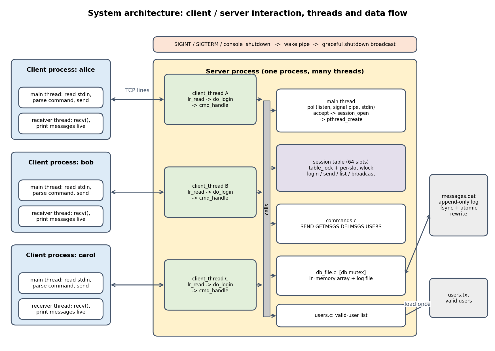
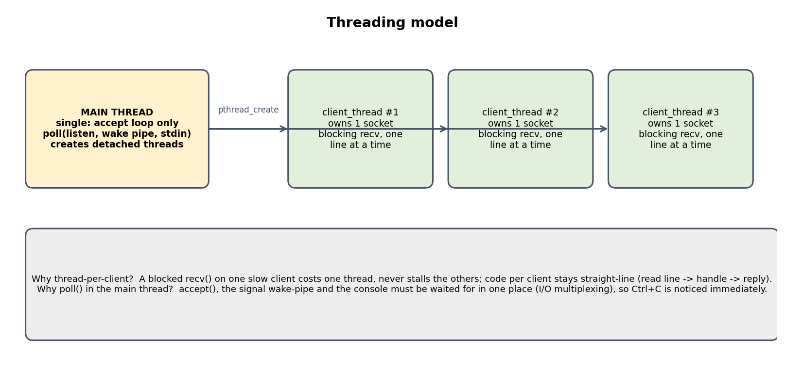
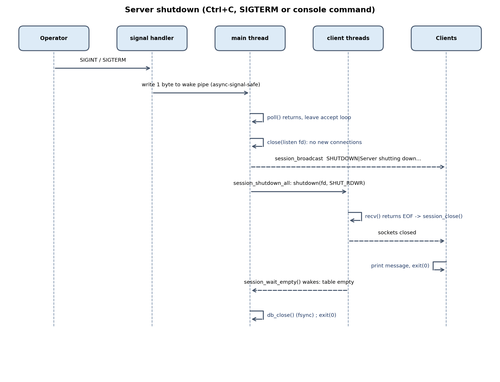
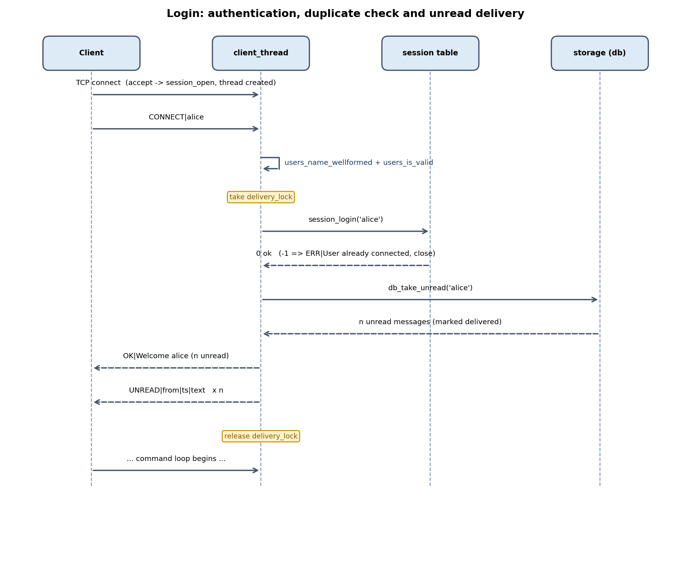
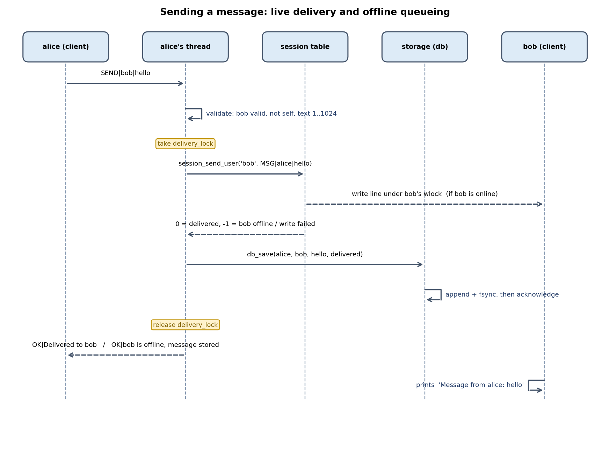
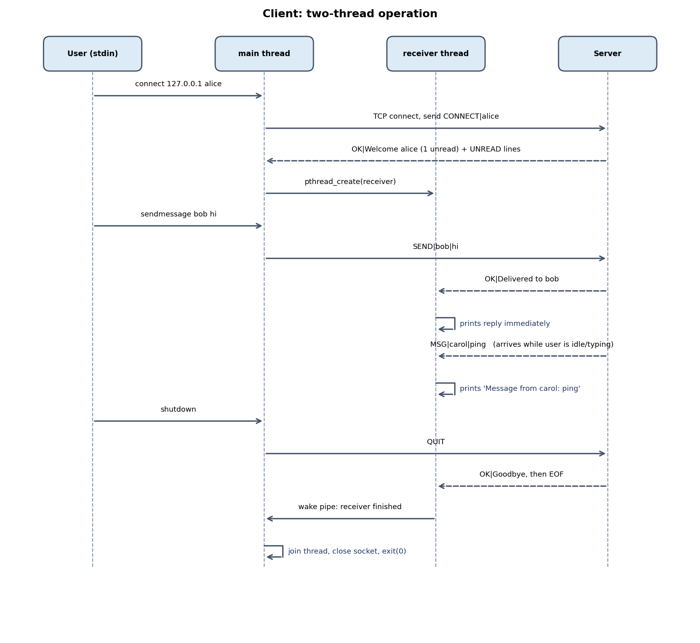
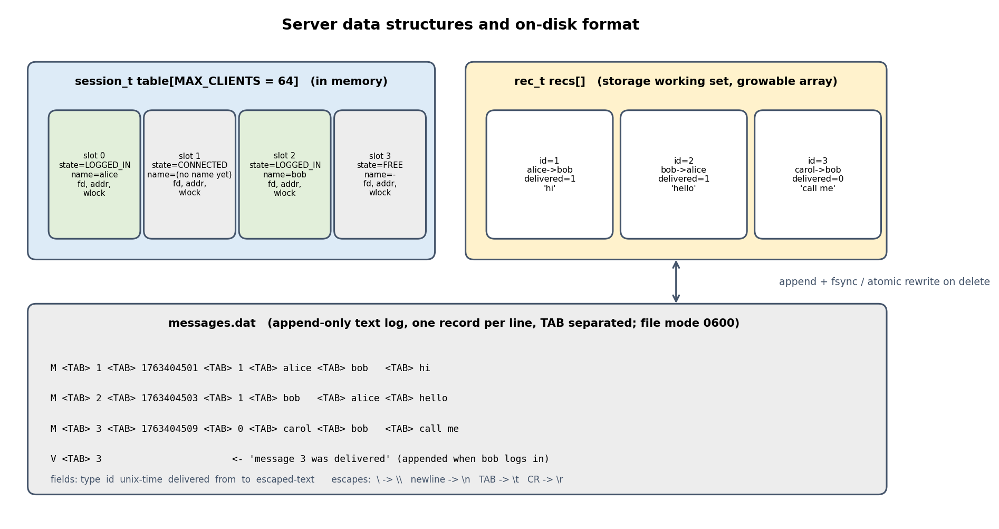
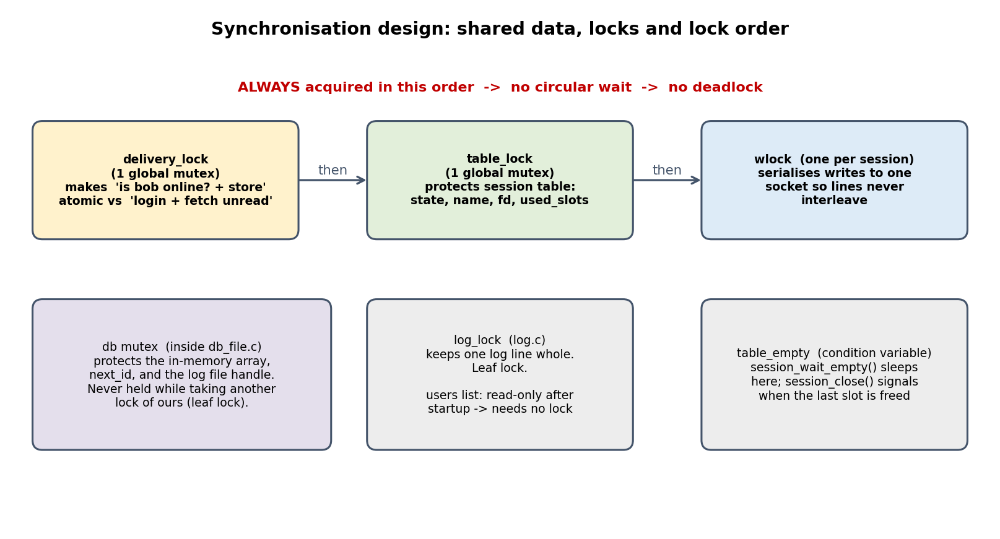

# Design Document: Multi-User Client-Server Messaging Application

## 1. Introduction

### 1.1 Purpose

This document describes the design of a multi-user messaging system built on the client-server model for the Operating Systems group project. It explains the architecture, the protocol, the concurrency design, the storage design, the testing strategy and, for every important decision, *why* it was taken. It is written so that any member of the group can defend the design in the viva.

### 1.2 Scope

The system has two programs, both written in C for Linux, with no third-party libraries:

| Program | Source | Role |
|---|---|---|
| `server` | `src/` | One process. Accepts many clients, routes messages between them, stores all messages, maintains the online-user list, shuts down gracefully. |
| `client` | `client/` | One process per user. Command-line interface: connect, send, receive in real time, retrieve and delete history, list online users, disconnect. |

### 1.3 Requirement traceability

Every requirement of the assignment brief is mapped to the code that implements it and the test that proves it.

| # | Requirement (from the brief) | Implemented in | Verified by |
|---|---|---|---|
| R1 | Server handles at least 5 concurrent clients | `server.c` accept loop + thread per client; `MAX_CLIENTS = 64` | `test_five_plus_concurrent_clients`, `test_six_real_clients_chat_concurrently`, ring stress test |
| R2 | Server maintains sessions, queues and communication between clients | `session.c`, `commands.c` | `test_live_delivery`, `test_session` unit tests |
| R3 | Server-side database for storage, retrieval, deletion | `db_file.c` (flat file) behind `db.h` | `test_db` (56 checks), `test_messages_persist_across_server_restart` |
| R4 | Valid-user list (file based) | `users.c`, `users.txt` | `test_invalid_user_rejected_and_connection_closed` |
| R5 | Cleanup and client notification at shutdown | `server.c` shutdown sequence | `test_sigint_broadcast_and_clean_exit`, `test_shutdown_under_load` |
| R6 | Client CLI: list online users, send, receive, retrieve, delete | `cli.c`, `client.c` | `test_cli` (81 checks), `e2e_client.py` |
| R7 | Real-time display of incoming messages | client receiver thread | `test_realtime_delivery` |
| R8 | Unread messages displayed at login | `do_login()` + `db_take_unread()` | `test_offline_message_shown_as_unread_at_login` |
| R9 | Graceful client disconnect on shutdown / server termination | `client.c` | `test_server_sigint_clients_notified_and_exit`, `test_clients_exit_nonzero_if_server_vanishes` |
| R10 | `connect <server IP> <user Name>` | `cli_parse()` | `test_connect` |
| R11 | Duplicate session rejected | `session_login()` | `test_duplicate_session_rejected`, 32-thread race test |
| R12 | `sendmessage <user> <message>`, error for invalid user | `do_send()` | `test_invalid_recipient` |
| R13 | `getmessages <user>`, `deletemessages <user>`, errors for invalid user | `do_getmessages()`, `do_deletemessages()` | `test_history_and_delete` |
| R14 | `getuserlist` | `do_users()` | `test_getuserlist` |
| R15 | Server shutdown broadcast "Server shutting down..." ; Ctrl+C or command | `server.c` | shutdown tests, console test |
| R16 | Client `shutdown` command; server removes user from active list | `CLI_SHUTDOWN`, `session_close()` | `test_shutdown_command_exits_cleanly` |
| R17 | Only the server stores messages; clients store nothing | client has no file I/O | by design (see 5.5) |
| R18 | Clients never connect to each other; all routing through server | protocol design | by design (see 2.2) |
| R19 | Multi-threaded server and client | thread per client; client main + receiver thread | architecture, TSan runs |
| R20 | Own data structures and message protocol | `session_t`, `rec_t`, `docs/PROTOCOL.md` | unit tests |
| R21 | OS concepts: processes, threads, mutexes, sockets, I/O multiplexing, persistence, signals | see section 8 | |
| R22 | Modular code: networking / threading / database / commands in separate files | `net.c`, `client_handler.c` + `session.c`, `db_file.c`, `commands.c` | code layout |
| R23 | Design document with architecture diagram, concurrency design, testing strategy and unit tests | this document | |

## 2. System architecture

### 2.1 Overview



The system is a classic **client-server** design:

- The **server** is one long-running process. Its *main thread* only waits for new connections, for a shutdown signal and (when run interactively) for console input, using a single `poll()` call. Each accepted connection gets its own **client thread** that owns that socket for its whole lifetime.
- Each **client** is a separate OS process with two threads: the *main thread* reads what the user types, the *receiver thread* prints whatever the server sends, so incoming messages appear instantly even while the user is idle or typing.
- All communication is over **TCP sockets** (the IPC mechanism), using a simple line-based text protocol (section 3).
- The server is the **single source of truth**: it keeps the session table in memory and the messages in a file.

### 2.2 Why every message goes through the server

The brief forbids client-to-client connections. This also solves real problems: clients behind firewalls/NAT can still talk (only the server needs to be reachable), the server can store messages for offline users, enforce the valid-user list and duplicate-login rule, and there is exactly one place where ordering and consistency are decided.

### 2.3 Processes and threads

| Entity | Count | Role |
|---|---|---|
| Server process | 1 | Owns the listening socket, session table, storage |
| Server main thread | 1 | `poll()` on listen socket, signal pipe, stdin; accepts; shutdown orchestration |
| Server client threads | 1 per connected client (max 64) | Read lines from one socket, authenticate, execute commands, write replies |
| Client processes | 1 per user | One user's session |
| Client main thread | 1 per client | stdin, command parsing, sending |
| Client receiver thread | 1 per connected client | recv(), prints server output |



### 2.4 Source layout

| File | Responsibility |
|---|---|
| `src/server.c` | `main()`: options, setup, `poll()` accept loop, signals, graceful shutdown |
| `src/net.c/.h` | **Networking:** listening socket, safe write helpers, buffered line reader |
| `src/session.c/.h` | **Threading/shared state:** session table, login, targeted send, broadcast, shutdown helpers, locks |
| `src/client_handler.c/.h` | **Per-connection thread:** login handshake, then command loop |
| `src/commands.c/.h` | **Command handling:** SEND, GETMSGS, DELMSGS, USERS, QUIT |
| `src/db.h`, `src/db_file.c` | **Database:** storage interface and its persistent flat-file implementation |
| `src/users.c/.h` | Valid-user list and username syntax check |
| `src/log.c/.h` | Thread-safe console event log |
| `src/protocol.h` | Shared constants and message kinds |
| `client/client.c` | Client `main()`, two threads, connection handling |
| `client/cli.c/.h` | Pure functions: command parser and output formatter (unit-testable) |
| `tests/` | C unit tests and Python end-to-end tests |

## 3. Protocol design

### 3.1 Format

Every message is **one line of text** ending in `\n` (a trailing `\r` is tolerated). Fields are separated by `|`; the **last field may contain `|`**, so chat text can contain any printable characters. Maximum line 2048 bytes, maximum chat text 1024 bytes.

**Why a text, line-based protocol?** It is trivial to debug (`nc localhost 5555` works as a client), TCP is a byte *stream* so we need explicit message boundaries and a newline is the simplest one, and it needs no byte-order or struct-packing handling. The cost is that a message cannot contain a newline, which is acceptable for a CLI chat.

### 3.2 Messages

| Direction | Message | Meaning |
|---|---|---|
| C → S | `CONNECT\|<user>` | Log in (must be the first line) |
| C → S | `SEND\|<to>\|<text>` | Send a message |
| C → S | `GETMSGS\|<user>` | Retrieve history with `<user>` |
| C → S | `DELMSGS\|<user>` | Delete history with `<user>` |
| C → S | `USERS` | List online users |
| C → S | `QUIT` | Disconnect |
| S → C | `OK\|<info>` / `ERR\|<reason>` | Result of a command |
| S → C | `UNREAD\|<from>\|<ts>\|<text>` | Offline message, sent right after login |
| S → C | `MSG\|<from>\|<text>` | Real-time message pushed to an online user |
| S → C | `HIST\|<from>\|<to>\|<ts>\|<text>` | One stored message in reply to `GETMSGS` |
| S → C | `USERLIST\|a,b,c` | Online users |
| S → C | `SHUTDOWN\|Server shutting down...` | Broadcast at server shutdown |

The full specification with an example conversation is in `docs/PROTOCOL.md`.

### 3.3 Session state machine

```
            connect()                CONNECT|user ok
  (none) ------------> CONNECTED -------------------------> LOGGED_IN
                          |  any failure: ERR + close            |  command loop
                          v                                      |  QUIT / EOF / SHUTDOWN
                        closed <---------------------------------+
```

A connection that is `CONNECTED` but not `LOGGED_IN` never appears in the user list and cannot run commands. Any login failure (malformed line, unknown user, duplicate session) sends one `ERR|...` line and closes the connection. This is deliberately strict: it keeps the server's state machine tiny and gives a hostile or confused client no second chance to probe.

### 3.4 Request/response discipline

After login every command line gets **exactly one** terminating reply (`OK|`, `ERR|` or `USERLIST|`; `GETMSGS` sends its `HIST|` lines first and ends with `OK|`). `MSG|` pushes can arrive at any time between replies, which is exactly why the client needs a separate receiver thread.

## 4. Server design

### 4.1 Start-up

`main()` parses `-p port -u users_file -d data_file`, loads the valid-user list, opens/recovers the message store, initialises the session table, installs signal handlers, creates the listening socket and enters the accept loop.

### 4.2 The accept loop (I/O multiplexing)



The main thread calls `poll()` on up to three descriptors:

1. the **listening socket** (readable = a client is waiting),
2. the read end of the **wake pipe** (written by the signal handler),
3. **stdin**, only when it is a terminal (so the operator can type `shutdown` or `users`).

When the listening socket is readable the thread calls `accept()`, claims a slot with `session_open()`, sets a send timeout on the socket and starts a detached client thread. If the table is full the client gets `ERR|Server full` and is closed.

**Why `poll()` + a self-pipe?** A thread blocked in `accept()` cannot also notice Ctrl+C. Signal handlers may only call async-signal-safe functions, so the handler does the one safe thing, `write()` one byte to a pipe, and `poll()` wakes up immediately. This is the standard way to combine signals with I/O multiplexing and avoids races.

### 4.3 Thread per client

Each `client_thread` runs this loop: read one line (`lr_read`), if not yet logged in run `do_login()` else `cmd_handle()`; on EOF/error/QUIT leave the loop, log the disconnect and call `session_close()`.

**Why thread-per-client rather than `fork()` or a single-threaded `select()` loop?**

| Option | Verdict |
|---|---|
| `fork()` per client | Separate address spaces cannot share the session table or message store without shared memory or extra IPC. Too heavy for a shared-state chat server. |
| One thread + `poll()` for all clients | Efficient, but every client needs a hand-written state machine for partial reads/writes; one slow operation (disk `fsync`) would stall everyone. |
| **Thread per client** | Shared memory makes the shared session table natural; the per-client code is simple straight-line logic; a blocked `recv()` costs only that client's thread. At the required scale (5..64 clients) thread cost is irrelevant. **Chosen.** |

The main thread still uses `poll()` (I/O multiplexing) for accept/signals/console, so both concepts are demonstrated.

### 4.4 The session table

```c
typedef struct session {
    slot_state_t state;        /* SLOT_FREE | SLOT_CONNECTED | SLOT_LOGGED_IN */
    int  fd;                   /* the client's socket */
    char name[MAX_USERNAME+1]; /* valid once LOGGED_IN */
    char addr[64];             /* "ip:port" for the log */
    pthread_mutex_t wlock;     /* serialises writes to fd */
} session_t;
static session_t table[MAX_CLIENTS];   /* guarded by table_lock */
```

A fixed array of 64 slots is used instead of a linked list because it needs no allocation (no leaks, no fragmentation), slot lookup is a trivial scan over a tiny array, and the capacity limit gives a natural "server full" policy. Every connection owns a slot from `accept()` until `session_close()` (not only after login) so that shutdown can reach connections that have not logged in yet.

Operations (all take `table_lock`): `session_open`, `session_login` (atomic duplicate check + claim), `session_close`, `session_send_user`, `session_list`, `session_is_online`, `session_broadcast`, `session_shutdown_all`, `session_wait_empty`.

### 4.5 Login (authentication, duplicate prevention, unread delivery)



1. The first line must be `CONNECT|<user>`.
2. The name must be well-formed (`[A-Za-z0-9_.-]`, 1-32 chars) **and** present in `users.txt`. Well-formedness is checked first so a hostile name such as `../etc/passwd` or one containing `|` is rejected before it touches any other code.
3. Under the **delivery lock**, `session_login()` checks all slots for the same name and claims it inside one critical section. Two simultaneous logins of the same name cannot both succeed.
4. Still under the delivery lock, unread messages are fetched (and marked delivered) and sent: first `OK|Welcome <user> (<n> unread)`, then `n` `UNREAD|` lines.

### 4.6 Command handling

`cmd_handle()` splits the line at the first `|` and dispatches case-insensitively. For `SEND` the arguments are split with a *limit* (`<to>` / `<text>`), so `|` inside the text survives. Validation order for `SEND`: recipient well-formed and in the user list, not yourself, text non-empty, text ≤ 1024 bytes.



### 4.7 Graceful shutdown

The sequence is shown in Figure 3. The key steps are: stop accepting; broadcast `SHUTDOWN|Server shutting down...`; call `shutdown(fd, SHUT_RDWR)` on every socket so threads blocked in `recv()` wake up with EOF and clean up themselves; wait on a condition variable until the table is empty (5 s timeout as a safety net); close the store (final `fsync`); exit with status 0.

Three triggers all use the same path: **SIGINT** (Ctrl+C), **SIGTERM**, and the console command `shutdown`.

## 5. Client design



### 5.1 Two threads

The brief requires the client to read user commands and incoming messages at the same time. The **main thread** `poll()`s stdin plus two pipes (receiver-finished, signals) and sends commands; the **receiver thread** blocks in `recv()` and prints. Output is serialised with a mutex; on a terminal the half-typed line is cleared and the prompt redrawn so a message does not corrupt what the user is typing.

### 5.2 Parser and formatter are pure functions

`cli_parse()` turns user input into a protocol line or an action; `cli_format()` turns a server line into display text. Neither touches sockets or the terminal, so they are unit-tested exhaustively (81 checks) without any network.

Commands accepted: `connect <ip> <user> [port]`, `sendmessage <user> <message>`, `getmessages <user>`, `deletemessages <user>`, `getuserlist`, `shutdown`, `help`. Before connecting, only `connect`, `help` and `shutdown` are legal.

### 5.3 Login handshake

`do_connect()` performs the handshake **synchronously before** the receiver thread exists: send `CONNECT|user`, read one line with a 5 s timeout. If it is `ERR|...` the error is shown and the client stays usable (retry with another name). If `OK|Welcome … (n unread)` it reads exactly `n` `UNREAD|` lines, then starts the receiver thread. Doing the handshake synchronously avoids a race between "login finished" and "start printing" and keeps the receiver's code simple.

### 5.4 Disconnecting

| Trigger | Behaviour | Exit code |
|---|---|---|
| `shutdown` command / Ctrl+D (stdin EOF) / Ctrl+C | Send `QUIT`, wait up to 3 s for the server to close, join receiver, close socket | 0 |
| Server announces `SHUTDOWN\|…` | Print it, then "Disconnected: server has shut down." | 0 |
| Connection vanishes without notice (server killed) | "Disconnected: connection to server lost." | 1 |

### 5.5 No local storage

The client never opens a file for messages; everything shown comes from the server on demand, satisfying "clients do not store anything locally".

## 6. Storage design

### 6.1 Interface

`db.h` defines the contract: `db_init`, `db_close`, `db_save`, `db_take_unread`, `db_history`, `db_delete`, `db_free`. The server code depends only on this header, so the implementation can be replaced (for example by SQLite) without touching the server. Passing `NULL` to `db_init()` gives a memory-only store, used by unit tests.

### 6.2 Data structures and file format



The working set is a growable array of `rec_t {id, from, to, ts, text, delivered}`. The file `messages.dat` is an **append-only text log**:

```
M <TAB> id <TAB> unix-time <TAB> delivered <TAB> from <TAB> to <TAB> escaped-text
V <TAB> id                                  (message id now delivered)
```

Text is escaped (`\` → `\\`, newline → `\n`, tab → `\t`, CR → `\r`) so a record never spans two lines. The file is created with mode 0600 (owner only).

### 6.3 Why a flat file and not SQLite

The brief allows either. A flat file was chosen because it needs no external library or package installation (the shared account cannot install packages), it makes the OS concepts explicit (`open`, `write`, `fsync`, `rename`, atomicity, crash recovery) which is the point of an OS course, and it is small enough to explain completely in a viva. The interface in `db.h` keeps the SQLite option open.

### 6.4 Durability and crash safety

| Operation | Mechanism | Guarantee |
|---|---|---|
| Save message | append one line, `fflush` + `fsync`, **then** acknowledge | An acknowledged message survives a crash or power loss |
| Mark delivered | append `V` line + `fsync` | If lost, worst case is a re-delivery after restart (at-least-once), never a lost message |
| Delete history | write the surviving records to `messages.dat.tmp`, `fsync`, `rename()` over the old file | `rename()` is atomic: after a crash the file is entirely old or entirely new, never half-deleted |
| Start-up | replay the log, skip malformed lines and a torn last line, then compact (rewrite) | A crash in the middle of an append loses at most the unfinished line, which was never acknowledged |

### 6.5 Concurrency in the store

One mutex protects the in-memory array, the id counter and the file handle. Every public function holds it for its whole duration. This serialises saves, which is acceptable at this scale and makes the module obviously race-free (verified by the 8-writer test and ThreadSanitizer).

## 7. Concurrency design

### 7.1 Shared data and the lock that protects each



| Shared data | Protected by | Used by |
|---|---|---|
| Session table (state, name, fd, count) | `table_lock` | all client threads, main thread |
| Bytes written to one client socket | per-session `wlock` | a thread replying to its own client, other threads pushing `MSG`/broadcast |
| "is X online + store" vs "login + fetch unread" | `delivery_lock` | `do_send()`, `do_login()` |
| Message array, next id, log file | db mutex (in `db_file.c`) | every `db_*` call |
| Console log output | `log_lock` | every thread |
| Valid-user list | none (read-only after start-up) | login, send, getmessages |
| "Table is empty" | `table_empty` condition variable | shutdown wait |

### 7.2 Lock order and deadlock freedom

**Order: `delivery_lock` → `table_lock` → `wlock`.** Every code path that holds more than one lock acquires them in this order and releases in reverse. The db and log mutexes are *leaf* locks (nothing else is acquired while holding them). Because a total order exists, no circular wait can form, so deadlock is impossible. Two paths illustrate it: `do_send` takes `delivery_lock`, then `session_send_user` takes `table_lock` then the target's `wlock`; a thread replying to its own client takes only `wlock`.

### 7.3 Race conditions found and how each is prevented

| Race | What could go wrong | Prevention |
|---|---|---|
| Two logins of the same name at the same instant | Both pass a "not online" check, two sessions exist | Check and claim in **one** `table_lock` critical section; tested with 32 racing threads × 20 rounds and 12 racing TCP clients |
| Message arrives while the receiver is logging in | Sender sees "offline", stores message; receiver already fetched its unread list; message stranded until next login | `delivery_lock` makes "online check + store" and "login + fetch unread" mutually exclusive; tested by `test_message_during_login_never_lost` (every message appears exactly once) |
| A reply and a pushed `MSG` written to the same socket by two threads | Bytes of two lines interleave and corrupt both | per-session `wlock`; tested with 8 threads × 200 lines |
| Write to a closed (or reused) descriptor | Data to the wrong user, or EBADF | `session_close()` marks the slot free **and** closes the fd under `table_lock`; other threads only write to a slot they found `LOGGED_IN` under that same lock |
| Signal handler touching shared data | Corrupted state, deadlock (non-async-signal-safe call) | The handler only `write()`s one byte to a pipe |
| Writing to a client that stopped reading | A pushing thread blocks forever holding `table_lock`, freezing everyone | `SO_SNDTIMEO` of 3 s on every client socket |
| `SIGPIPE` on writing to a closed peer | Process killed | `MSG_NOSIGNAL` on every `send()` and `SIGPIPE` ignored |
| Threads still running at exit | Use-after-free of tables | `session_wait_empty()` (condition variable) before closing the store |

### 7.4 Fairness and scalability notes

`table_lock` is held only for short operations (a scan over 64 slots plus at most one bounded `send()`), so contention is negligible for the required load. The store serialises writes; this would be the first thing to change (finer-grained locks or SQLite) if the system had to serve thousands of clients.

## 8. Operating-system concepts used

| Concept (from the brief) | Where and how |
|---|---|
| **Process management** | Server and every client are separate processes (`fork`/`exec` by the shell); the server serves multiple client processes concurrently |
| **Concurrency and threading** | `pthread_create` (detached) per client in `server.c`; client main + receiver thread |
| **Synchronisation** | `pthread_mutex_t` (`table_lock`, `delivery_lock`, `wlock`, db mutex, `log_lock`), `pthread_cond_t` (`table_empty`) with `pthread_cond_timedwait` |
| **Inter-process communication** | TCP stream sockets: `socket`, `bind`, `listen`, `accept`, `connect`, `send`, `recv`; a pipe is used for signal-to-thread communication |
| **I/O management** | `poll()` multiplexing in the server main loop and client main loop; `SO_SNDTIMEO`/`SO_RCVTIMEO` timeouts; handling of partial reads/writes and `EINTR` |
| **File system and persistence** | `open`, `write`, `fsync`, `rename`, `fopen("a")`, file permissions 0600, crash recovery by log replay |
| **Signal handling** | `sigaction` for `SIGINT`/`SIGTERM`; async-signal-safe handler + self-pipe; `SIGPIPE` ignored; graceful shutdown broadcast |
| Memory management | Fixed-size session table (no heap), growable record array with `realloc`, ownership rules for `db_take_unread()` results (`db_free`) |

## 9. Error handling and edge cases

| Situation | Behaviour |
|---|---|
| Unknown user at login | `ERR\|Invalid username`, connection closed |
| Second login of an online user | `ERR\|User already connected`, connection closed, first session unaffected |
| Server full (64 connections) | `ERR\|Server full`, connection closed |
| `SEND` to unknown user / yourself / empty text / > 1024 bytes | `ERR\|…`, nothing stored |
| `GETMSGS`/`DELMSGS` with missing or invalid user | `ERR\|Usage…` / `ERR\|Invalid user` |
| Unknown command, empty line, NUL bytes | `ERR\|Unknown command`; server unaffected |
| Line longer than 2048 bytes | `ERR\|Line too long`, connection closed |
| Message split across TCP packets / CRLF line endings | Handled by the buffered line reader |
| Peer disconnects abruptly | EOF/error on `recv()` → slot freed, user removed from the list, logged |
| Message for an offline user | Stored undelivered; delivered once at next login |
| Server killed (`kill -9`) | Clients detect EOF and exit with code 1; stored messages survive on disk |
| Corrupt or torn data file | Bad lines skipped and logged, rest recovered |
| Disk write failure on save | Client receives `ERR\|Storage failure, message not saved`; the message is never reported as stored |

## 10. Testing strategy

### 10.1 Levels

| Level | Tool | What it proves | Size |
|---|---|---|---|
| Unit: net | `tests/test_net.c` | Line reader (partial reads, CRLF, over-long, EOF), safe writer, SIGPIPE safety | 19 checks |
| Unit: session | `tests/test_session.c` | Login, duplicate rejection, relogin, capacity, broadcast, shutdown wake-up, **32-thread duplicate-login race ×20**, **8×200 concurrent writes without interleaving** | 141 checks |
| Unit: commands | `tests/test_commands.c` | Every command including error paths | 29 checks |
| Unit: storage | `tests/test_db.c` | Semantics, persistence across restart, delivered flag, delete+compaction, escaping, corrupt/torn files, 0600 mode, limits, **8-writer concurrency**, mixed concurrent operations | 56 checks |
| Unit: client | `tests/test_cli.c` | Parser and formatter, malformed input | 81 checks |
| Integration (raw protocol) | `tests/integration.py` | Real server binary over TCP: 8 concurrent clients, duplicate/invalid login, live and offline delivery, history/delete, malformed input, server-full, **8-client × 60-message ring stress**, login-vs-send race, SIGINT/SIGTERM broadcast, shutdown under load | 25 tests |
| End-to-end (real client) | `tests/e2e_client.py` | Real client processes against the real server: complete user workflows, 6 concurrent clients, client Ctrl+C / EOF / `shutdown`, server death, **persistence across a server restart** | 22 tests |

### 10.2 Sanitizers

The whole suite is also built and run with **ThreadSanitizer** (`make tsan`: detects data races and lock-order inversions) and **AddressSanitizer + UBSan** (`make asan`: memory errors, leaks, undefined behaviour). The tests assert on process exit codes, so any sanitizer report fails the run. Result: clean.

### 10.3 Validating the tests themselves

A deliberate bug was injected into the client's message formatting; four end-to-end tests failed as expected and passed again after the bug was reverted, which shows the tests detect regressions. Writing the tests also found a real defect (a missing reply for `getmessages` with no argument), fixed and covered by a unit test.

### 10.4 How to run

```
make test      # all unit tests + both Python suites
make tsan      # everything under ThreadSanitizer
make asan      # everything under AddressSanitizer + UBSan
```

## 11. Build and deployment

`make` builds `build/server` and `build/client` with `gcc -std=gnu11 -Wall -Wextra -Werror -pthread`. No external libraries. The script `scripts/setup_csit203_user.sh` creates an unprivileged shared account with the project cloned, built and tested, so the team can try the system over SSH without any root rights.

## 12. Limitations and possible extensions

- The server serialises storage writes through one mutex; fine for the required scale, would need finer locking or a database for very large deployments.
- A live message written to a socket whose peer died silently (no FIN received yet) is recorded as delivered; a delivery acknowledgement in the protocol would close this gap.
- Usernames are case-sensitive; user list is loaded once at start-up (no reload on change).
- No encryption or password authentication (out of scope; the brief specifies a valid-user list only). TLS could wrap the socket layer.
- A single global `delivery_lock` serialises sends and logins; per-recipient locks would increase parallelism.

## 13. Module ownership (for the presentation)

| Member | Modules |
|---|---|
| **Jofrey** | Server core and concurrency: `server.c`, `net.c`, `session.c`, `client_handler.c`; concurrency and shutdown design (sections 4, 7) |
| **Ibrahim** | Storage and message logic: `db.h`, `db_file.c`, `users.c`, `commands.c`; storage design (section 6) |
| **Krishang** | Client, protocol and testing: `client/`, `protocol.h`, `docs/PROTOCOL.md`, test suites; client design and testing (sections 3, 5, 10) |

Every member is expected to be able to explain **all** modules; `docs/DOCUMENTATION.md` contains a function-by-function walkthrough, a decision log and a viva question bank for that purpose.
